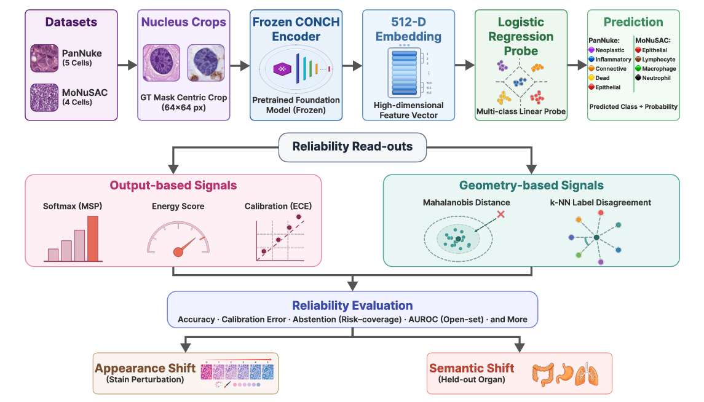

# Which Reliability Signal to Trust? Output vs. Representation Space Uncertainty Under Distribution Shift in Pathology Foundation Models

Official code for the MI4MedFM @ MICCAI 2026 workshop paper.

> Updated on 2026.08.11

## Key Features

- Compares **output-space** reliability signals (softmax confidence, energy score, calibration error) against **representation-space** signals (Mahalanobis distance, k-NN label disagreement) on a frozen pathology foundation model.
- Evaluates both families under **two controlled distribution shifts**: HED stain perturbation (appearance) and held-out organs (semantic), plus leave-one-class-out open-set detection.
- Finds a **shift-dependent asymmetry**: output-space reliability degrades under both shift types, while representation geometry responds selectively, and the stronger family reverses across held-out classes.
- Backbone is never fine-tuned, so every result is obtained from cached embeddings and a linear probe.

## Links

- **Paper**: <!-- TODO: proceedings / arXiv link -->
- **Backbone**: [CONCH](https://github.com/mahmoodlab/CONCH) (gated, requires Hugging Face access)
- **Datasets**: [PanNuke](https://arxiv.org/abs/2003.10778) and [MoNuSAC](https://monusac-2020.grand-challenge.org/)

## Details

Reliable uncertainty estimation matters for deploying pathology foundation models, but different reliability signals respond differently to different kinds of distribution shift. We freeze CONCH as a feature extractor, train a multinomial logistic probe on cached 512-D embeddings, and measure how each reliability family behaves as the input distribution moves.

<p align="center">
  
</p>

## Datasets

| Dataset | Source | Used here | Nuclei | Classes |
|---|---|---|---|---|
| PanNuke | [Gamper et al. 2020](https://arxiv.org/abs/2003.10778) | Part 1 only (2,656 images) | 51,365 | 5 |
| MoNuSAC | [Verma et al. 2021](https://monusac-2020.grand-challenge.org/) | train + test splits | 46,686 | 4 |

Each annotated nucleus becomes a 64x64 GT-mask-centric crop, encoded once through frozen CONCH into a 512-D embedding. All partitions are image-grouped to prevent leakage.

## Get Started

### Main requirements

The notebooks were run on Kaggle with a T4 GPU.

```
torch
timm
transformers==4.40.0
scikit-learn
numpy
conch          # pip install git+https://github.com/mahmoodlab/CONCH.git
```

### CONCH access

CONCH is gated. Request access on Hugging Face, then store your token as a Kaggle secret named `HF_TOKEN`. The notebooks read it with:

```python
from kaggle_secrets import UserSecretsClient
token = UserSecretsClient().get_secret("HF_TOKEN")
```

No token is stored in this repository.

### Run order

| # | Notebook | What it does | Runtime |
|---|---|---|---|
| 1 | `notebooks/01_pannuke_conch_embeddings.ipynb` | Builds PanNuke nucleus crops, encodes them through frozen CONCH, caches embeddings | ~1h40m on T4 |
| 2 | `notebooks/02_pannuke_reliability.ipynb` | Probe, calibration, geometry, open-set, stain and organ shift on PanNuke | minutes on cached embeddings, longer where crops are re-encoded |
| 3 | `notebooks/03_monusac_conch_embeddings.ipynb` | Same as (1) for MoNuSAC | ~1h25m on T4 |
| 4 | `notebooks/04_monusac_reliability.ipynb` | Same as (2) for MoNuSAC | as above |

Notebooks 2 and 4 depend on the cached embeddings written by 1 and 3. Outputs are preserved in the committed notebooks, so every number in the paper can be read without re-running anything.

## Where each result comes from

Cell indices are zero-based and refer to the committed notebooks with their outputs intact.

| Paper | Notebook | Cell |
|---|---|---|
| Table 2, in-distribution (PanNuke) | `02_pannuke_reliability` | 4, 6 |
| Table 2, in-distribution (MoNuSAC) | `04_monusac_reliability` | 4 |
| Table 3, per-class F1 | `02_pannuke_reliability` / `04_monusac_reliability` | 4 |
| Table 4, open-set AUROC (PanNuke) | `02_pannuke_reliability` | 10 |
| Table 4, open-set AUROC (MoNuSAC) | `04_monusac_reliability` | 7 |
| Table 5, stain severity sweep | `02_pannuke_reliability` | 13 |
| Table 5, organ-shift row | `02_pannuke_reliability` | 14 |
| Table 6, per-class geometry (PanNuke) | `02_pannuke_reliability` | 9 |
| Table 6, per-class geometry (MoNuSAC) | `04_monusac_reliability` | 6 |
| Table 7, MoNuSAC organ folds | `04_monusac_reliability` | 8 |
| Figure 2, both shift arms | `02_pannuke_reliability` | 13, 14 |
| Figure 3, selective classification | `02_pannuke_reliability` | 6, 13, 14 |
| Section 4.5, per-sample error detection | `02_pannuke_reliability` | 15 |
| Section 4.2, MoNuSAC stain severity | `04_monusac_reliability` | 11 |

## Reproducibility notes

- **Protocols differ per dataset.** MoNuSAC uses strict leave-one-organ-out over its four organs. PanNuke withholds six of nineteen tissues at random, repeated over five draws, so the PanNuke arm is a multi-tissue holdout rather than leave-one-out.
- **The MoNuSAC organ arm merges rare classes.** Macrophage and Neutrophil are combined into `Other`, giving a three-class problem. Those results are not directly comparable with the four-class in-distribution baseline.
- **Seeds.** Stain-shift results average over 3 perturbation seeds on PanNuke and 5 on MoNuSAC. Bootstrap confidence intervals use 1,000 resamples at the nucleus level.
- **MoNuSAC stain results vary considerably across seeds.** See `04_monusac_reliability` cell 11 for the standard deviations.
- Figures in the paper were produced separately and their plotting code is not included here. All underlying numbers are in the notebook outputs listed above.

## Feedback and Contact

<!-- TODO: contact email, group/lab page -->

## Citation

<!-- TODO: update once proceedings pages are assigned -->

```bibtex
@inproceedings{TODO2026reliability,
  title     = {Which Reliability Signal to Trust? Output vs. Representation Space Uncertainty Under Distribution Shift in Pathology Foundation Models},
  author    = {TODO},
  booktitle = {Mechanistic Interpretability for Medical Foundation Models (MI4MedFM), MICCAI 2026 Workshops},
  year      = {2026}
}
```

## Acknowledgements

This work uses the [CONCH](https://github.com/mahmoodlab/CONCH) foundation model from the Mahmood Lab. CONCH is distributed under its own licence, which is separate from and unaffected by the licence of this repository.

## License

This repository is released under the [MIT License](LICENSE).
